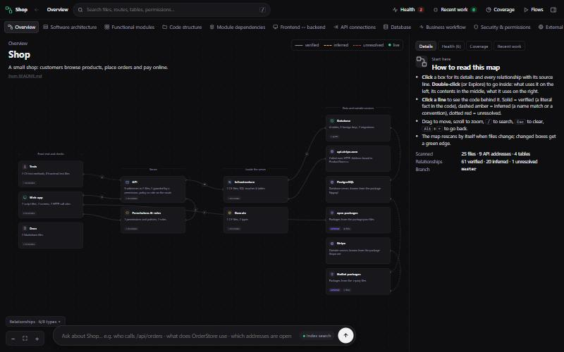
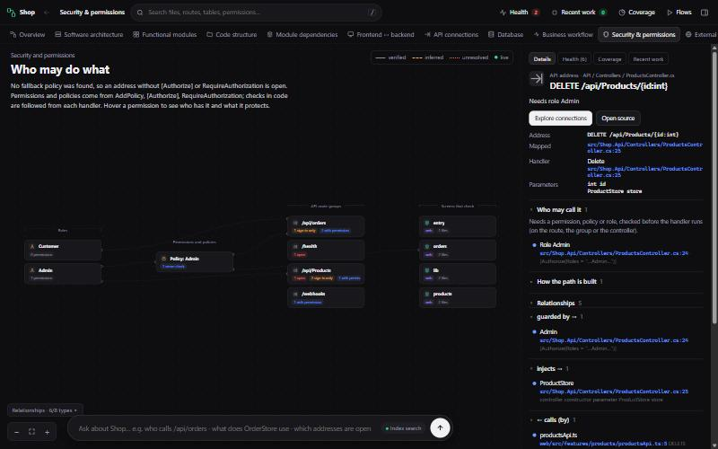

# Architecture Explorer

A Claude Code skill that turns a repository into an interactive, live architecture map: layers, modules, API
routes, database tables, permissions, screens, outside services and the business workflow, with every relationship
traced to the file and line it comes from.



Built for people who are building a system and want to *see* it: what calls what, who may call which address, which
tables a feature touches, where a new feature belongs, and what changed. It runs on your computer, reads the code,
and never changes it.

## What you get

- **Eleven views of one scan:** overview, software architecture, functional modules, code structure, module
  dependencies, frontend ↔ backend, API connections, database, business workflow, security & permissions, external
  integrations.
- **Explore anything:** double-click a box to see what uses it, what's inside, and what it uses. Click a line to see
  the code behind it; every `file:line` opens the source.
- **Honest about certainty:** each relationship is *verified* (a literal fact in the code), *inferred* (a name match
  or a convention) or *unresolved*. A Coverage tab compares raw text matches with what was understood and lists
  everything left over.
- **Health findings:** addresses that change data with no authorization, sign-in-only writes, frontend calls that
  match no route, routes nobody calls, permissions nothing checks, tenant tables without row-level security, secrets
  in settings files. Each comes with its places and a ready prompt for Claude Code.
- **Live:** it watches the repository and updates the open page when files change, with git's uncommitted changes
  marked.
- **Search and Ask:** find files, routes, tables, permissions; ask "who calls /api/orders" or "which addresses are
  open" (index search, no AI, nothing leaves your machine).



## What it understands

| Area | Understood |
|---|---|
| C# / ASP.NET Core | Minimal APIs (`MapGet`…, route groups, helper methods that map routes), controllers with attribute routes, `[Authorize]` / `[AllowAnonymous]`, `RequireAuthorization`, `AddPolicy`, `IsInRole`, the fallback policy, DI registrations, handler and constructor injection, project references |
| Data | `.sql` migrations replayed in order (tables, columns, foreign keys, indexes, triggers, row-level security), SQL in C# strings (Dapper, Npgsql, ADO.NET), EF Core `DbSet`s |
| Frontend | TypeScript / JavaScript with `fetch`, `axios`, `api.get(...)` clients and `apiGet`-style helpers matched to server routes; imports with `tsconfig` path aliases; React Router, switch-based routers and Next.js `app/` / `pages/` screens |
| Outside services | URLs in code, and well-known client packages (PostgreSQL, SQL Server, Redis, Stripe, Twilio, SendGrid, AWS, Azure, Auth0, Sentry, OpenAI, ...) |
| Project conventions | Your own permission enum, route guards and permission checks, and your documented business process, through an optional `.architecture-explorer.json` ([reference](skills/architecture-explorer/references/configuration.md)) |

Not modeled yet: EF Core migrations written in C#, JavaScript backends (Express, Next.js API routes), GraphQL, gRPC.
C# is read by a C#-aware lexer, not compiled, so links between C# types are name matches and marked inferred.

## Install

You need [Claude Code](https://claude.com/claude-code) and Node.js 20 or later.

**As a plugin** (from Claude Code):

```
/plugin marketplace add LemonadeHighway/Architecture-Mapping
/plugin install architecture-explorer@architecture-explorer
```

**As a plain skill:** copy `skills/architecture-explorer` into `~/.claude/skills/` (for all your projects) or into a
project's `.claude/skills/`.

Then, in any repository, ask Claude something like *"show me the architecture of this project"* or *"open the
architecture explorer"*. Claude starts the explorer, opens the map, and can set up a config for your project's own
conventions.

**Without Claude:**

```bash
node skills/architecture-explorer/explorer/server.mjs --root /path/to/your/repo
```

```bash
node skills/architecture-explorer/explorer/cli.mjs --root /path/to/your/repo
```

The server prints its address (`http://127.0.0.1:5190` or the next free port). The CLI prints a summary, the coverage
table and the findings; `--node <id>` and `--find <text>` answer questions from the terminal.

The explorer has no runtime dependencies. For TypeScript and JavaScript files it uses the TypeScript parser from the
scanned project's `node_modules`; if the project has none, run `npm install` once in
`skills/architecture-explorer/explorer` (it installs only `typescript`).

## Privacy and safety

- Listens on 127.0.0.1 only and refuses requests for any other host name.
- Read-only: it never writes to the repository; it runs only read-only git commands (`status`, `log`, `rev-parse`).
- Only files the scan indexed can be opened from the page; secret-looking values in JSON settings are masked.
- No network calls, no telemetry, no AI in the page.

## Develop

```bash
cd skills/architecture-explorer/explorer
npm install
npm test
```

The tests scan a small sample shop (`test/make-fixture.mjs`) end to end, check each scanner on small inputs, and
start the real server to prove that a file change reaches the open page.

## License

MIT, see [LICENSE](LICENSE).
